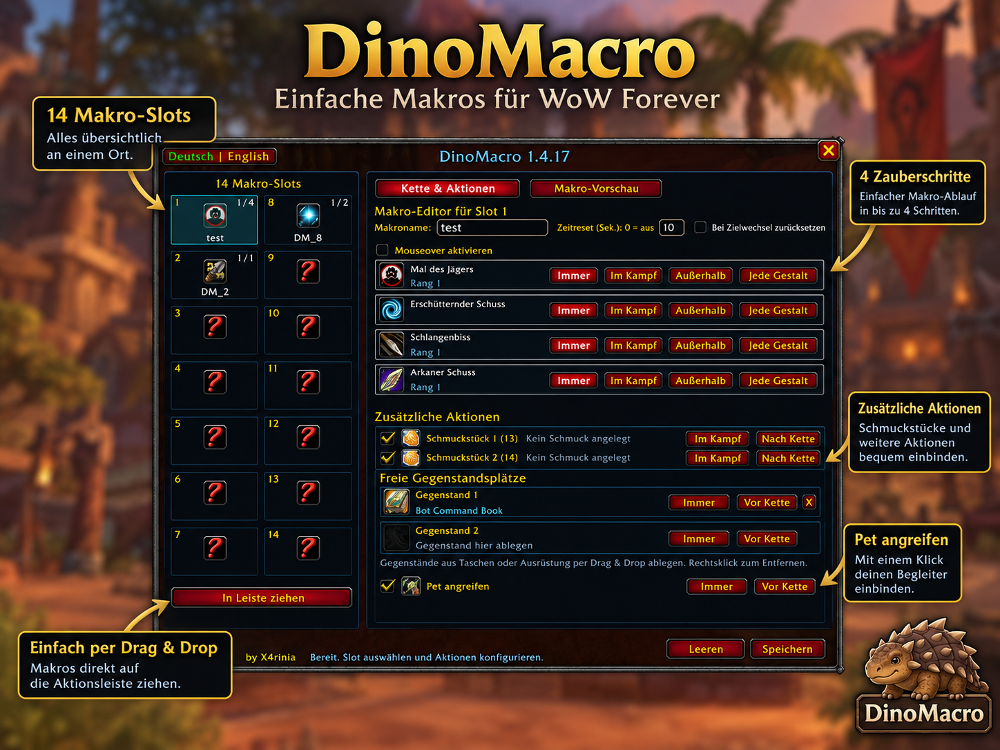
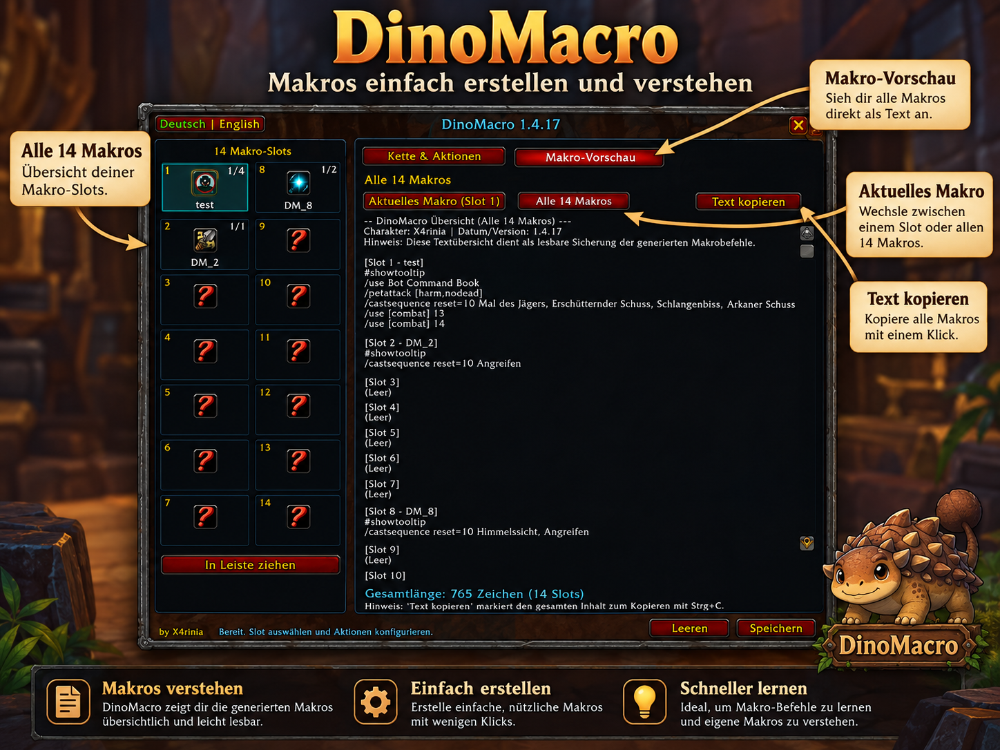

<p align="center">
  <br>
  
</p>

<h1 align="center">🦖 DinoMacro – Makros einfach erstellen und verstehen!</h1>

<p align="center">
  <b>WoW Forever Edition &bull; v1.4.17 Beta &bull; by X4rinia</b><br>
  <i>Speziell für WoW Forever (_classic_beta_) und Classic Clients entwickelt</i>
</p>

<p align="center">
  <a href="https://github.com/x4rinia/DinoMacro/releases/latest"></a>
  
  
  
</p>

---

## 📖 Über DinoMacro

Ich habe ein kleines Addon namens **DinoMacro** speziell für **WoW Forever** entwickelt.  
Die Idee dahinter ist, das Erstellen von WoW-Makros einfacher und übersichtlicher zu machen, besonders für Spieler, die sich mit Makrobefehlen noch nicht so gut auskennen.

> 💡 **Das Konzept:**  
> DinoMacro soll nicht nur dabei helfen, Makros schnell zu erstellen, sondern auch zeigen, **wie sie funktionieren**. So kann man nach und nach die verschiedenen Befehle kennenlernen und irgendwann vielleicht sogar eigene Makros ganz ohne Addon schreiben.

---

## 📸 Screenshots

| 14 Makro-Slots & Zauberketten-Editor | Bedingungen, Schmuckstücke & Live-Vorschau |
| :---: | :---: |
| [](screenshots/screen1.png) | [](screenshots/screen2.png) |
| *14 konfigurierbare Makro-Slots mit Drag & Drop* | *Bedingungen (Mouseover, Kampf, Schmuckstücke, Petattack & Vorschau)* |

---

## ✨ Funktionen

- **14 Makro-Slots:** Zum einfachen Erstellen und Verwalten deiner Makros.
- **Bis zu 4 Zauberschritte:** Flüssige Zauberketten pro Makro definieren.
- **Drag & Drop:** Zauber und Items einfach direkt aus dem Zauberbuch oder Inventar hineinziehen.
- **Schmuckstücke & Gegenstände:** Schmuckstücke (`/use 13`, `/use 14`), Tränke und andere Gegenstände nahtlos einbinden.
- **Pet-Angriff:** Automatisches `/petattack` für Jäger, Hexenmeister und Begleiterklassen.
- **Kampf-Bedingungen:** Bedingungen für im Kampf (`[combat]`) und außerhalb des Kampfes (`[nocombat]`).
- **Mouseover & Haltungen:** Mouseover- (`[@mouseover,exists,nodead]`) sowie Gestalt- und Haltungsbedingungen.
- **Reset-Optionen:** Zeitreset (`reset=X`) und Reset bei Zielwechsel (`reset=target`).
- **Makro-Vorschau:** Zum direkten Anschauen, Verstehen und Kopieren der generierten Blizzard-Befehle.
- **Deutsch & Englisch:** Vollständig zweisprachige Benutzeroberfläche und automatische Zauberübersetzung für deutsche und englische Clients.
- **Aktionsleisten-Drag:** Fertige Makros mit Klick auf „In Leiste ziehen“ direkt auf die normale WoW-Aktionsleiste legen.
- **Blizzlike Sequenz-Icons:** Nutzt dynamisches `#showtooltip`, wodurch Blizzard auf der Aktionsleiste automatisch zum nächsten Zauber (Icon, Tooltip, Cooldown) weiterschaltet.
- **In-Place Bearbeitung:** Saubere Aktualisierung bestehender Makros mit `EditMacro` ohne störende Duplikate im Makrofenster.
- **Automatische Duplikat-Bereinigung:** Entfernt verwaiste Makro-Duplikate früherer Versionen automatisch beim Speichern.

---

## 🛠️ Status: Noch in Entwicklung

DinoMacro ist aktuell ein kleines Hobbyprojekt und wurde speziell für den WoW-Forever-Client entwickelt.

> ⚠️ **Hinweis:** Es können noch Fehler auftreten oder einzelne Funktionen nicht wie erwartet funktionieren. Falls euch etwas auffällt, freue ich mich über Rückmeldungen und Verbesserungsvorschläge im Issue-Tracker oder im Forum.  
> Wenn WoW Forever offiziell erscheint, werde ich DinoMacro möglicherweise auch auf **CurseForge** veröffentlichen.

---

## 📦 Installation

### 1. Über WoWUp (Empfohlen für automatische Updates)
1. Öffne die **WoWUp**-App.
2. Gehe auf den Reiter **Addons suchen** und klicke auf **Aus URL installieren** (*Install from URL*).
3. Gib die GitHub-URL ein:
   ```text
   https://github.com/x4rinia/DinoMacro
   ```
4. Klicke auf **Importieren / Installieren**. WoWUp erkennt automatisch die neuesten Releases und hält das Addon aktuell.

### 2. Manuelle Installation
1. Lade die neueste `DinoMacro-vX.X.X.zip` aus den [GitHub Releases](https://github.com/x4rinia/DinoMacro/releases/latest) herunter.
2. Entpacke den Ordner `DinoMacro` in dein WoW-Addon-Verzeichnis:
   ```text
   World of Warcraft/_classic_beta_/Interface/AddOns/
   World of Warcraft/_retail_/Interface/AddOns/
   World of Warcraft/Interface/AddOns/ (1.12 Forever)
   ```
3. Starte World of Warcraft neu oder führe `/reload` im Spiel aus.

---

## 🎮 Befehle im Spiel

| Befehl | Beschreibung |
|---|---|
| `/dinomacro` oder `/dm` | Öffnet das Hauptfenster von DinoMacro |
| `/dm debug` | Aktiviert oder deaktiviert den Debug-Modus |
| `/dm reset` | Setzt Fensterpositionen und Einstellungen zurück |

---

## 🌐 Elysium-WoW

Entdecke auch mein World of Warcraft Projekt **Elysium-WoW** mit besonderen Serverfeatures:  
👉 **[Zu Elysium-WoW wechseln (http://elysium-wow.ddns.net/)](http://elysium-wow.ddns.net/)**

---

<p align="center">
  <b>DinoMacro – Einfach erstellen. Verstehen. Lernen.</b><br>
  <i>by X4rinia ❤️</i><br>
  <small>Konzept und Idee von mir, bei der Programmierung teilweise KI-unterstützt umgesetzt.<br>
  Viel Spaß beim Ausprobieren! 🦖</small>
</p>
